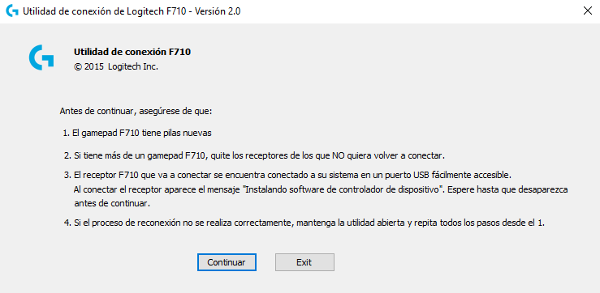
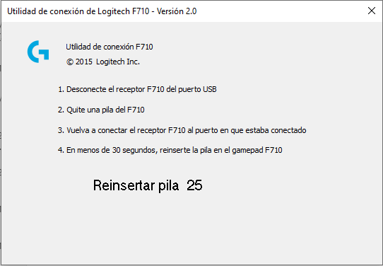
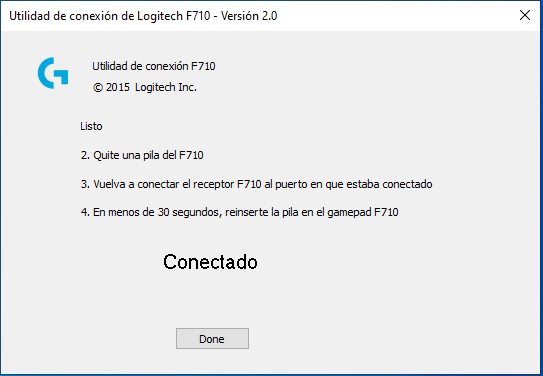

# Logitech F710 setup

Use the Windows utility below to recover the connection between an F710 gamepad and its USB receiver. Once connected, use Ubuntu to check the controls and calibrate the joystick interface used by this package.

Pairing the F710 gamepad with its USB dongle is performed on a Windows computer using Logitech's connection utility. After pairing, move the dongle to the Ubuntu computer to use the gamepad and calibrate it.

## Windows 10 connection utility

The reference executable was downloaded from Logitech's website on **07-10-2026** for use with Windows 10.

| Field | Value |
| --- | --- |
| Publisher | Logitech |
| Utility | Wireless Gamepad F710 Connect Utility |
| File version reference | 2.15.264, as identified by the executable filename |
| Reference executable | [F710ConnectUtility_2.15.264.exe](windows/F710ConnectUtility_2.15.264.exe) |
| Download page | [Logitech F710 downloads](https://support.logi.com/hc/en-us/articles/360024703714--Downloads-Wireless-Gamepad-F710) |
| SHA-256 of the bundled copy | `e8b3400acad4c3563d8ce6abb564a3d29f24e04cd9b44962819392b07b31e67a` |

On the manufacturer's download page, select Windows 10 and look for the F710 connection utility. The page also offers executables for Windows 8 and Windows 7; select the version that matches your operating system.

The executable is third-party Logitech software and remains subject to Logitech's applicable terms. Its inclusion does not relicense it under this package's Apache-2.0 license. Availability as a public download does not by itself establish redistribution permission.

### Reconnect the gamepad

1. On the Windows 10 computer, open `windows/F710ConnectUtility_2.15.264.exe`. The first image shows the utility's icon.

   

2. Before starting the pairing sequence, make sure the F710 USB dongle is connected to an easily accessible USB port on the Windows PC and **both batteries are installed in the gamepad**. Use fresh batteries and unplug the receivers of any other F710 gamepads. Wait for any device-driver installation message to disappear, then click **Continuar**. Keep the dongle connected and both batteries installed until you begin step 3.

   

3. Follow the reconnection screen in this exact order:

   - Unplug the F710 USB dongle from the PC, leaving **both batteries in the gamepad**.
   - Remove **one battery** from the gamepad.
   - Reconnect the USB dongle to the same USB port on the PC.
   - Reinsert the removed battery within **30 seconds**, following the countdown displayed by the utility.

   

4. Wait until the utility displays **Conectado**, then click **Done**. If reconnection fails, keep the utility open and repeat the preparation and reconnection steps, as indicated by the initial screen.

   

## X/D input mode

The physical **X/D switch** selects how the gamepad reports its controls to the computer: **X** selects XInput and **D** selects DirectInput. See [Logitech's input-mode explanation](https://support.logi.com/hc/en-us/articles/360023400073-Using-the-input-mode-switch-on-the-F710-to-select-DirectInput-or-XInput).

Choose the mode before testing or calibrating in Ubuntu and keep it unchanged during teleoperation. Switching modes can change the reported axes and buttons, so a ROS mapping checked in one mode should be checked again before using the other. The example YAML does not declare an X/D mode; verify its axis and button indices in `jstest-gtk`, especially the deadman button, before enabling robot motion.

The X/D switch is separate from the **MODE** button. Keep the MODE state unchanged as well while checking the control mapping.

## Ubuntu testing and calibration with jstest-gtk

Stop teleoperation before testing or calibrating. Connect the paired receiver to the Ubuntu computer and keep the gamepad's X/D selector and MODE state consistent with the ROS configuration you intend to use; changing them can change the reported controls.

Install the tester and the tools used to save calibration:

```bash
sudo apt update
sudo apt install jstest-gtk joystick
jstest-gtk
```

1. Select the F710 in the device list and open its properties. Note the device path shown by the application, for example `/dev/input/js0`; with multiple controllers, it may have a different number.
2. Move both sticks through their full travel, operate the triggers and directional pad, and press each button. Check that the displayed axes and buttons respond, and that the sticks return close to the centre when released.
3. Open **Calibration** and start **Calibrate**. Follow the application's prompts to capture the neutral positions and full axis travel, then accept the calibration. Button labels can vary with the installed version or language.
4. Repeat the control check. Confirm the sticks return to the centre and reach both ends of their travel. Calibration does not choose the ROS deadman button or velocity mapping; those belong to the teleoperation YAML.

Save the calibration for the actual device path shown by the tester:

```bash
sudo jscal-store /dev/input/js0
```

To restore it explicitly:

```bash
sudo jscal-restore /dev/input/js0
```

The Ubuntu `joystick` package provides support for restoring saved calibration on connection through udev rules. Reconnect the receiver and check the values again in `jstest-gtk` to confirm persistence on your machine; use the explicit restore command if necessary.

The calibration performed above applies to this package because `joy_linux` reads the same `/dev/input/js*` device that you calibrated with `jstest-gtk`. Other applications may read the gamepad differently and therefore ignore this calibration. See the [jstest-gtk documentation](https://github.com/Grumbel/jstest-gtk) and the [Ubuntu calibration-saving manual](https://manpages.ubuntu.com/manpages/noble/man1/jscal-store.1.html).

Before resuming teleoperation, check that `joy_linux_node.dev` in your parameter file matches the tested device and that the axes, deadman button and speed controls match your configuration. The package's example is [example_logitech_f710_teleoperation.yaml](../../config/example_logitech_f710_teleoperation.yaml).
